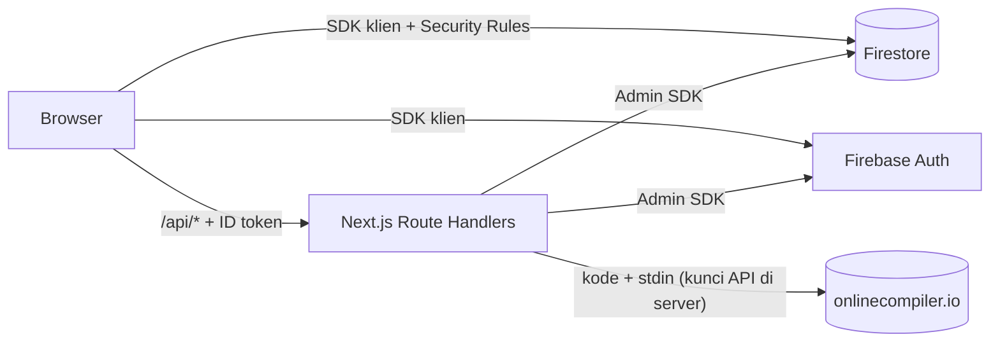
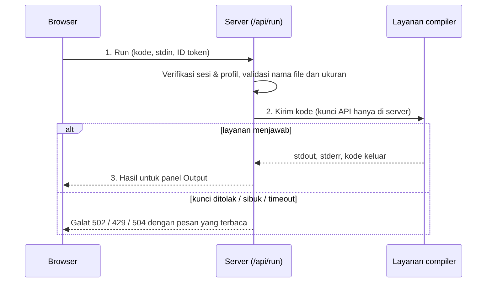
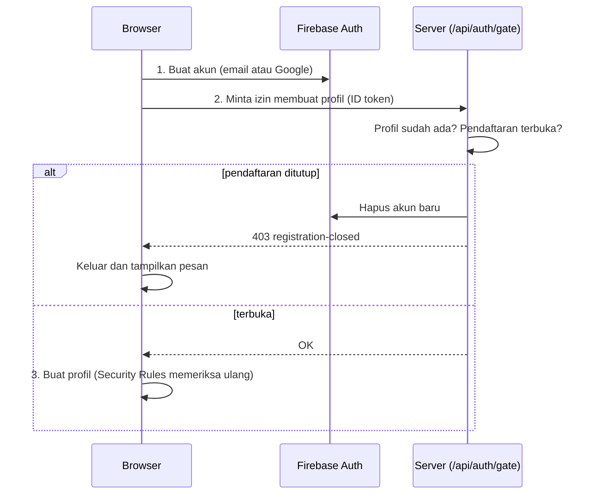

<div align="center">


# mycode-database

**Rumah online untuk kode Anda — folder sendiri, editor di browser, dan compiler Java bawaan, di perangkat apa pun.**


[Fitur](#-fitur) · [Arsitektur](#-arsitektur) · [Mulai Cepat](#-mulai-cepat) · [Konfigurasi](#-konfigurasi) · [API](#-referensi-api) · [Keamanan](#-keamanan) · [Peta Jalan](#-peta-jalan--batasan-yang-diketahui) · [Hak Cipta](#-hak-cipta)

</div>

---

## Ringkasan

mycode-database adalah aplikasi web untuk menyimpan, mengedit, dan menjalankan kode, terutama bagi pelajar. Setiap pengguna memiliki ruang kerja (*workspace*) pribadi berisi folder dan file Java; admin mengelola pengguna, peran, dan pendaftaran.

Prinsip rancangan:

| Prinsip | Penerapan |
|---|---|
| **Firestore untuk kode dan metadata** | Pohon folder (`nodes`) dipisah dari isi kode (`fileContents`) agar daftar file tetap ringan. |
| **Kode tidak dijalankan di Vercel** | Vercel tidak memiliki JDK. Eksekusi dikirim oleh server ke layanan compiler eksternal. |
| **Server sebagai penjaga** | Pembatasan pendaftaran, penghapusan akun, dan eksekusi kode ditegakkan di server, bukan hanya di UI. |
| **Aman secara bawaan** | Admin masuk dalam *safe mode* (hanya-baca) sampai sengaja dimatikan. |

> **Hak cipta:** kode sumber ini dipublikasikan agar dapat **dilihat dan dipelajari**. Tidak ada lisensi yang memberi izin menyalin, memodifikasi, atau menyebarkannya tanpa izin tertulis pemilik. Lihat [Hak Cipta](#-hak-cipta). Panduan teknis di bawah ditujukan bagi pemilik/pengelola proyek.

---

## ✨ Fitur

### Workspace
- **Folder bersarang** (hingga kedalaman 12): buat, ganti nama, pindah, hapus.
- **Pindah dengan drag and drop**, atau lewat menu **Move to…** (praktis di ponsel).
- **Template awal** saat membuat file: *Empty class*, *Hello, World!*, *Variables & types*, *Loops*, *Read input (Scanner)*.

### Editor
- CodeMirror 6 dengan tema One Dark: sorotan sintaks Java, nomor baris, lipat kode, dan autocompletion.
- **Autosave** 900 ms setelah berhenti mengetik; `Ctrl+S` menyimpan seketika.
- Banyak tab, penanda perubahan belum tersimpan, dan peringatan sebelum menutup halaman.

### Menjalankan kode
- **Run** atau `Ctrl+Enter` mengompilasi dan menjalankan file yang sedang terbuka.
- Panel bergaya terminal: tab **Output** (stdout, stderr, kode keluar, durasi) dan tab **Input** (stdin untuk program ber-`Scanner`).

### Import & Export
Tersedia di menu titik tiga Explorer.
- **Folder:** *Import files here…* (`.java` atau `.zip`, struktur folder terjaga) dan *Export folder (.zip)*.
- **File:** *Download file*.
- Aturan impor sama ketatnya dengan "New file/folder": nama valid, ukuran, kedalaman, dan teks UTF-8. File yang bentrok nama **dilewati**, tidak menimpa. Ringkasan hasil ditampilkan setelah impor.

### Akun & administrasi
- Login **Email + Password** dan **Google**; username unik; lupa kata sandi lewat tautan reset.
- Dashboard: *Overview* (jumlah folder/file, ukuran kode, 5 file terakhir), *Account*, *Settings* (ukuran font, word wrap, kurangi animasi).
- Panel admin: daftar pengguna, buka workspace pengguna, ubah peran, hapus akun, dan **saklar buka/tutup pendaftaran** (ditegakkan di server).
- **Safe mode** admin: melihat kode pengguna lain boleh, mengubahnya hanya setelah safe mode dimatikan.
- Akun yang dinonaktifkan atau dicabut di Firebase otomatis dikeluarkan dari sesi (diperiksa tiap 15 detik).

---

## 🏗 Arsitektur



**Alur menjalankan kode**



**Alur gerbang pendaftaran**



Kunci admin Firebase dan kunci API compiler **tidak pernah** meninggalkan server.

### Teknologi

| Lapisan | Teknologi |
|---|---|
| Framework | Next.js 16 (App Router, Turbopack), React 19 |
| Bahasa | TypeScript (mode `strict`) |
| Autentikasi & data | Firebase Authentication, Cloud Firestore |
| Server | Route Handlers Next.js, Firebase Admin SDK |
| Editor | CodeMirror 6 (`@uiw/react-codemirror`) |
| Zip | `fflate` |
| Compiler | onlinecompiler.io (utama); Piston (opsional, belum diuji) |
| Hosting | Vercel (disarankan) |

---

## 🚀 Mulai Cepat

**Prasyarat:** Node.js ≥ 22, npm, akun Firebase, dan (agar Run aktif) kunci API onlinecompiler.io.

```bash
npm install
cp .env.local.example .env.local   # lalu isi nilainya (lihat Konfigurasi)
npm run dev
```

Buka <http://localhost:3000>.

| Perintah | Fungsi |
|---|---|
| `npm run dev` | Server pengembangan |
| `npm run build` | Build produksi |
| `npm run start` | Jalankan hasil build |
| `npm run typecheck` | Pemeriksaan tipe TypeScript |

> Sebelum mencoba login atau Run, selesaikan [Konfigurasi](#-konfigurasi) dan publikasikan `firestore.rules`.

---

## ⚙️ Konfigurasi

### Variabel lingkungan

Salin `.env.local.example` → `.env.local`. **Jangan meng-commit** berkas ini (sudah ada di `.gitignore`).

| Variabel | Lingkup | Sumber |
|---|---|---|
| `NEXT_PUBLIC_FIREBASE_API_KEY` | Publik | Firebase → Project settings → Your apps |
| `NEXT_PUBLIC_FIREBASE_AUTH_DOMAIN` | Publik | idem |
| `NEXT_PUBLIC_FIREBASE_PROJECT_ID` | Publik | idem |
| `NEXT_PUBLIC_FIREBASE_STORAGE_BUCKET` | Publik | idem |
| `NEXT_PUBLIC_FIREBASE_MESSAGING_SENDER_ID` | Publik | idem |
| `NEXT_PUBLIC_FIREBASE_APP_ID` | Publik | idem |
| `FIREBASE_ADMIN_PROJECT_ID` | 🔒 Server | Service account (JSON) |
| `FIREBASE_ADMIN_CLIENT_EMAIL` | 🔒 Server | Service account (JSON) |
| `FIREBASE_ADMIN_PRIVATE_KEY` | 🔒 Server | Service account (JSON), termasuk `\n`, dibungkus tanda kutip ganda |
| `RUNNER_PROVIDER` | 🔒 Server | `onlinecompiler` atau `piston`; kosong = Run dinonaktifkan |
| `ONLINECOMPILER_API_KEY` | 🔒 Server | Halaman API keys onlinecompiler.io |
| `ONLINECOMPILER_JAVA_COMPILER` | 🔒 Server | Opsional; mengganti id compiler Java (bawaan `openjdk-25`) |
| `PISTON_URL`, `PISTON_API_KEY` | 🔒 Server | Opsional; server Piston milik sendiri (belum diuji) |

> Konfigurasi web Firebase (`NEXT_PUBLIC_*`) memang publik. Data dilindungi oleh **Security Rules** dan **Authorized domains**, bukan oleh kerahasiaan nilai ini. Rahasia **tidak boleh** diberi awalan `NEXT_PUBLIC_`.

> Perubahan variabel lingkungan di Vercel baru berlaku setelah **redeploy**.

### Firebase

1. Buat project Firebase.
2. **Authentication:** aktifkan *Email/Password* dan *Google*.
3. **Firestore:** buat database (mode production).
4. Isi `NEXT_PUBLIC_FIREBASE_*` dari *Project settings → Your apps*.
5. **Service account:** *Project settings → Service accounts → Generate new private key*; isi tiga variabel `FIREBASE_ADMIN_*`. Jangan simpan berkas JSON di repositori.
6. **Security Rules:** salin seluruh isi [`firestore.rules`](./firestore.rules) ke *Firestore → Rules*, lalu **Publish** (atau `npx firebase-tools deploy --only firestore:rules`).
   > Rules **tidak ter-deploy otomatis** bersama aplikasi. Publikasikan ulang setiap kali berkas berubah.
7. **Authorized domains:** daftarkan `localhost` dan domain produksi di *Authentication → Settings*.

### Compiler

1. Buat kunci API di onlinecompiler.io, lalu isi `ONLINECOMPILER_API_KEY`.
2. Setel `RUNNER_PROVIDER=onlinecompiler`. Tanpa ini, tombol Run menampilkan "Not available yet".
3. Id compiler Java bawaan adalah `openjdk-25`. Daftar id yang tersedia ada di `GET https://api.onlinecompiler.io/api/compilers/`; bila berbeda, isi `ONLINECOMPILER_JAVA_COMPILER`.
4. Paket gratis memiliki kuota bulanan dari penyedia. Pantau di akun onlinecompiler.io.

Batas eksekusi: hanya Java, dan hanya **file yang sedang terbuka** yang dikirim (belum ada proyek multi-file). Waktu tunggu server 25 detik.

### Akun admin pertama

Peran admin sengaja tidak bisa diberikan lewat pendaftaran:

1. Daftar akun lewat aplikasi.
2. Firestore → koleksi `users` → dokumen akun Anda.
3. Ubah field `role` menjadi `admin`.

Admin baru mulai dengan **safe mode ON**.

### Deploy ke Vercel

1. Dorong repositori ke GitHub, lalu **Import** di Vercel.
2. Isi semua variabel lingkungan di *Settings → Environment Variables*.
3. Deploy, lalu tambahkan domain Vercel ke *Authorized domains* Firebase.
4. Pastikan `firestore.rules` terbaru sudah dipublikasikan.

> ⚠️ Blok `overrides` di `package.json` (`jwks-rsa` → `jose@4.15.9`) diperlukan agar `firebase-admin` kompatibel dengan runtime serverless Vercel. Menghapusnya, atau tidak meng-commit `package-lock.json`, dapat memunculkan `ERR_REQUIRE_ESM`.

---

## 🗂 Model Data

Firestore menyimpan kode dan metadata.

| Koleksi / dokumen | Isi utama |
|---|---|
| `users/{uid}` | `email`, `username`, `displayName`, `role`, `settings` (font, word wrap, kurangi animasi), `adminSafeMode` (admin) |
| `usernames/{username}` | pemetaan username unik → uid |
| `settings/app` | saklar pendaftaran (`registrationOpen`) |
| `nodes/{id}` | folder dan metadata file: `ownerUid`, `parentId`, `type`, `name`, `size`, waktu |
| `fileContents/{id}` | isi kode (maksimal 200.000 karakter); id sama dengan node file |

Aturan nama: username 3–20 karakter (`a-z 0-9 _`); nama file/folder maksimal 64 karakter; nama file harus pengenal Java yang sah berakhiran `.java` (nama file = nama class).

---

## 🔌 Referensi API

Semua endpoint memakai `POST` dengan header `Authorization: Bearer <Firebase ID token>`. Token diverifikasi di server beserta pengecekan pencabutan sesi. Galat berformat `{ "error": "...", "code": "..." }`.

| Endpoint | Akses | Fungsi |
|---|---|---|
| `/api/auth/gate` | Pengguna | Menolak profil baru (dan menghapus akun Auth barunya) saat pendaftaran ditutup |
| `/api/auth/session` | Pengguna | Validasi sesi (dipakai pemeriksaan berkala klien) |
| `/api/run` | Pengguna | Kompilasi dan jalankan satu file Java |
| `/api/admin/delete-user` | Admin, safe mode OFF | Hapus akun Authentication beserta seluruh datanya |

**`POST /api/run`**

```json
// Permintaan
{ "language": "java", "fileName": "Main.java", "code": "...", "stdin": "..." }

// Respons 200
{ "phase": "run", "stdout": "...", "stderr": "...", "exitCode": 0, "durationMs": 812 }
```

Validasi: `language` harus `"java"`; `fileName` cocok `^[A-Za-z_][A-Za-z0-9_]{0,63}\.java$`; `code` ≤ 200.000 karakter; `stdin` ≤ 10.000 karakter.

| Status | `code` | Arti |
|---|---|---|
| 400 | `bad-language` / tanpa kode | Masukan tidak valid |
| 401 | `no-token`, `invalid-session`, `session-revoked` | Sesi tidak valid |
| 403 | `no-profile` | Akun Auth tanpa profil |
| 429 | `runner-error` | Compiler sibuk atau kuota habis |
| 502 | `runner-error` | Kunci ditolak atau layanan tidak terjangkau |
| 503 | `runner-unavailable` | `RUNNER_PROVIDER` belum diatur |
| 504 | `runner-timeout` | Compiler terlalu lama menjawab |

---

## 🔐 Keamanan

| Area | Penerapan |
|---|---|
| Autentikasi | ID token diverifikasi di server dengan `checkRevoked`; akun nonaktif/dicabut ditolak seketika |
| Otorisasi | Peran admin dibaca ulang dari Firestore di server; Security Rules mencegah pengguna mengubah `role` sendiri |
| Safe mode | Admin tidak dapat mengubah kode, peran, atau menghapus akun orang lain selama safe mode ON; ditegakkan oleh Rules dan server |
| Pendaftaran | Saklar ditegakkan tiga lapis: UI, gerbang server, dan Security Rules; termasuk pendaftaran Google |
| Gagal-tertutup | Jika gerbang pendaftaran gagal, akun baru dihapus dan sesi ditutup (tidak ada akun/sesi tanpa profil) |
| Eksekusi kode | Wajib login dan berprofil; nama file dan ukuran divalidasi; kunci compiler hanya dibaca server |
| Import | Nama, ukuran, kedalaman, dan encoding divalidasi; entri tersembunyi dan path berbahaya (`../`) diabaikan |
| Rahasia | Kunci admin Firebase dan kunci compiler hanya dibaca server |
| Header HTTP | HSTS, `X-Content-Type-Options`, `X-Frame-Options`, `Referrer-Policy`, `Permissions-Policy` |
| Dependensi | `npm audit` melaporkan 0 kerentanan saat dokumen ini ditulis; jalankan berkala |

Pelaporan celah keamanan: lihat [SECURITY.md](./SECURITY.md).

<details>
<summary><b>Daftar periksa bagi pengelola (sebelum rilis)</b></summary>

- [ ] `.env.local` dan berkas JSON *service account* tidak pernah ter-commit (`git log --all -- .env.local`, dan cari nama berkas rahasia lain di riwayat).
- [ ] Jika ada rahasia yang pernah ter-commit, **putar (rotate)**: buat ulang private key Firebase dan kunci API compiler. Menghapus berkas tidak cukup karena tetap ada di riwayat.
- [ ] `firestore.rules` terbaru sudah dipublikasikan di Firebase Console.
- [ ] *Authorized domains* Firebase hanya berisi domain yang dipakai.
- [ ] Kuota/penggunaan akun compiler dipantau.
- [ ] Akun Authentication tanpa profil (sisa pendaftaran yang gagal) dibersihkan di Firebase Console → Authentication.
- [ ] *Dependabot alerts*, *Private vulnerability reporting*, dan (bila tersedia) *Secret scanning* aktif di GitHub.

</details>

---

## 📱 Catatan Perangkat Mobile

- Explorer dibuka lewat tombol menu di bilah atas; memilih file menutupnya otomatis.
- Memindahkan di layar sentuh: gunakan menu titik tiga → **Move to…** (drag and drop dirancang untuk mouse).
- Impor memakai pemilih berkas bawaan perangkat; ekspor mengunduh `.zip`/`.java` lewat pengunduhan browser.

---

## 🧭 Peta Jalan & Batasan yang Diketahui

Transparan soal kondisi saat ini:

| Status | Item |
|---|---|
| ⚠️ Belum ada | Tes otomatis dan CI |
| ⚠️ Belum ada | Pembatasan laju (*rate limit*) pada `/api/run`; setiap pengguna yang masuk memakai kuota compiler yang sama |
| ⚠️ Sebagian | CSP masih *Report-Only* dan memperbolehkan `'unsafe-inline'` untuk skrip |
| ⚠️ Sebagian | Security Rules dipublikasikan manual dan belum diuji dengan Firebase Emulator |
| ⚠️ Sebagian | Impor banyak file menulis dalam batch 100 operasi; batasnya terhadap rules belum diuji di proyek asli |
| ⚠️ Sebagian | Provider Piston ditulis dari dokumentasi dan belum diuji ke server nyata |
| ⚠️ Terbatas | Hanya Java, dan hanya satu file per eksekusi |
| ⚠️ Belum ada | Verifikasi email dan fitur hapus akun oleh pengguna sendiri |
| 🔧 Rencana | Menegakkan CSP, menambah tes untuk API dan rules, rate limit per pengguna, otomatisasi deploy rules |
| 🔧 Rencana | Eksekusi proyek multi-file, dukungan bahasa tambahan |

---

## 🧰 Pemecahan Masalah

| Gejala | Penyebab & solusi |
|---|---|
| `auth/unauthorized-domain` saat login Google | Tambahkan domain ke *Authorized domains* Firebase |
| `permission-denied` | `firestore.rules` belum dipublikasikan ulang, atau mengedit milik orang lain saat safe mode ON |
| Semua `/api/*` menjawab 500 "Server error." | Periksa `FIREBASE_ADMIN_*` di Vercel, redeploy, lihat log fungsi |
| `ERR_REQUIRE_ESM` di log | Pastikan blok `overrides` di `package.json` ada dan `package-lock.json` ter-commit |
| Run: "Not available yet" | `RUNNER_PROVIDER` kosong; setel `onlinecompiler` lalu redeploy |
| Run: "rejected the API key" | Periksa/ganti `ONLINECOMPILER_API_KEY` |
| Run: "busy or the monthly limit" | HTTP 429 dari layanan; tunggu atau cek kuota |
| Run: `Compiler service error (HTTP 4xx): …` | Mis. id compiler tidak dikenal; cek daftar id dan isi `ONLINECOMPILER_JAVA_COMPILER` |
| Impor banyak file gagal "permission-denied" | Kecilkan `IMPORT_BATCH` di `src/lib/fs.ts` |
| Daftar ditolak "Sign-ups are currently closed" | Saklar pendaftaran OFF (perilaku yang benar); nyalakan di Dashboard → Admin |

---

## 🗃 Struktur Proyek

```text
src/
├─ app/
│  ├─ page.tsx              Landing page
│  ├─ login/ · register/    Autentikasi
│  ├─ dashboard/            Overview, Account, Settings, Admin
│  ├─ app/                  Editor (Explorer, tab, editor, terminal)
│  └─ api/                  Route Handlers: auth/gate, auth/session, run, admin/delete-user
├─ components/
│  ├─ ide/                  Ide, FileTree, NodeDialogs, Terminal
│  ├─ tabs/                 Tab dashboard
│  └─ landing/              Nav, EditorMock, AuthRedirect
└─ lib/
   ├─ runner/               Pemilih provider compiler (onlinecompiler, piston)
   ├─ fs.ts · tree.ts       Akses Firestore dan fungsi murni pohon file
   ├─ transfer.ts           Logika import/export
   └─ server-auth.ts · firebase-admin.ts   Verifikasi token, cek admin (server)
firestore.rules             Security Rules Firestore
next.config.mjs             Header keamanan & CSP
.env.local.example          Templat variabel lingkungan (tanpa nilai)
SECURITY.md                 Kebijakan pelaporan celah keamanan
CONTRIBUTING.md             Panduan kontribusi
```

---

## 🤝 Kontribusi

Saran dan laporan bug sangat dihargai lewat *Issues*. Saat ini proyek **tidak menerima Pull Request**. Detail ada di [CONTRIBUTING.md](./CONTRIBUTING.md).

## 📄 Hak Cipta

**© 2026 gillandghaz. Seluruh hak dilindungi (All Rights Reserved).**

Repositori ini **tidak memakai lisensi sumber terbuka**. Kode sumber dipublikasikan agar dapat dilihat dan dipelajari. Menyalin, memodifikasi, menjalankan sebagai layanan, atau mendistribusikan ulang kode sumber memerlukan **izin tertulis dari pemilik**. Untuk meminta izin, hubungi pemilik lewat profil GitHub.

Dependensi pihak ketiga (mis. Next.js, React, Firebase SDK, CodeMirror, fflate) tetap tunduk pada lisensinya masing-masing.
